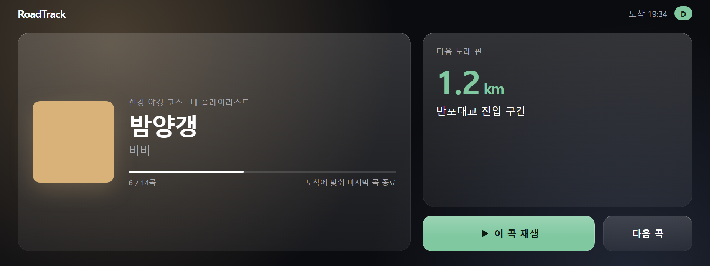
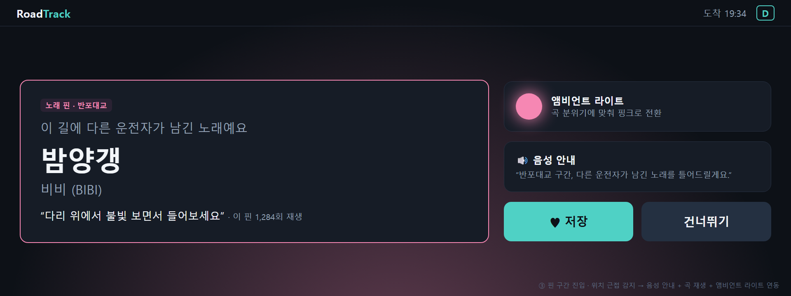
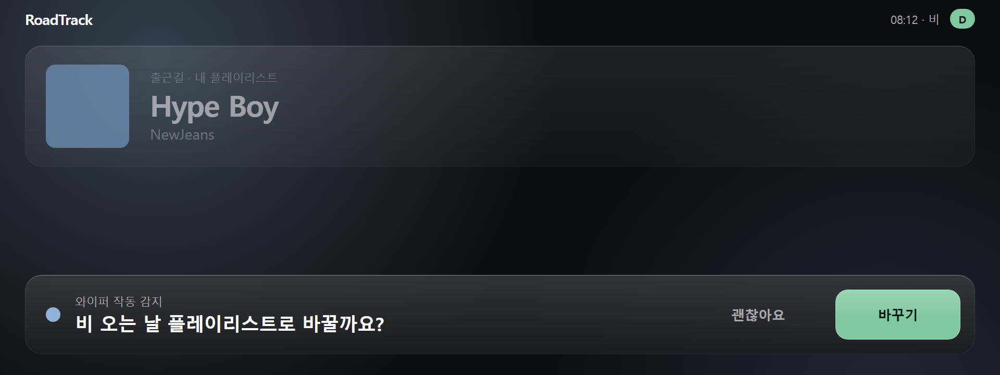

# 로드트랙 (RoadTrack) - 음악으로 고르는 드라이브

내 플레이리스트에 맞춰 드라이브 코스를 짜주고, 길 위에 다른 운전자가 남긴 노래를 들려주는 Pleos Connect 차량용 음악 드라이브 앱입니다.

> 현대자동차그룹 차량용 앱 개발 공모전 출품작

## 주요 기능
- **플레이리스트 맞춤 코스**: 플레이리스트 재생 시간에 맞는 드라이브 코스를 추천하고 내비 경로로 바로 적용
- **노래 핀**: 도로 구간에 노래를 남기고, 그 구간에 들어선 다른 운전자에게 재생
- **상황 인식 추천**: 와이퍼·전조등·좌석 착석 신호로 비·밤·동승자 상황에 맞는 곡 제안
- **곡별 앰비언트 라이트**: 곡이 바뀔 때마다 실내 조명 색 변경 (노래 핀 작성자가 고른 색, 없으면 무드 색)
- **멀티 음악 앱 지원**: 멜론 등 사용자가 쓰는 음악 앱으로 재생 연결

## 시연 영상 (화면 시안)
- [docs/RoadTrack_demo.mp4](docs/RoadTrack_demo.mp4) — 6개 핵심 화면 흐름 (42초)

## 화면 시안
| | |
|---|---|
|  |  |
|  |  |
|  |  |

## 실행 방법
1. Pleos Connect Emulator(AVD, Pleos Connect v2.1.0 / API 34)를 실행합니다.
2. APK 설치: `adb install apk/RoadTrack_RoadTrack_release.apk`
3. 런처에서 **로드트랙**을 실행합니다.
4. Virtual Console에서 차량 신호를 바꿔 동작을 확인합니다.
   - 기어 P → 코스 추천 화면 / 기어 D → 주행 화면
   - 와이퍼 ON → "비 오는 날 플레이리스트로 바꿀까요?" 제안
   - 전조등(로우빔) ON → 야간 무드 제안, 조수석 착석 → 함께 듣기 제안

소스에서 빌드: `./gradlew assembleRelease` (JDK 17)

## 테스트 환경 및 필요한 설정
- Android API 28 이상, Gradle 8.0 이상, Kotlin
- Pleos Connect SDK: Vehicle, NaviHelper, FusedLocation, TextToSpeech, SpeechToText
- 사용 SDK: `ai.pleos.playground:Vehicle:2.3.2` (Maven: `https://nexus-playground.pleos.ai/repository/maven-releases/`)
- 퍼미션: `CAR_DRIVE`(기어), `CAR_WINDOWS`(와이퍼), `CAR_LIGHTS`/`CONTROL_CAR_LIGHTS`(전조등·앰비언트), `CAR_SEATS`(착석)
- 재생은 `MEDIA_PLAY_FROM_SEARCH` 인텐트로 설치된 음악 앱에 넘기므로, 에뮬레이터에 음악 앱이 없으면 재생 버튼은 안내 메시지만 띄웁니다.

## Pleos Connect 에뮬레이터 버전 및 화면 규격
- 대상: Pleos Connect Emulator v2.1.0 (Android 14, API 34), 가로 화면
- _(실기 에뮬레이터 화면 규격 확인 후 갱신 예정)_

## APK
- 위치: [`apk/`](apk/) (`팀명_앱이름_release.apk`)
