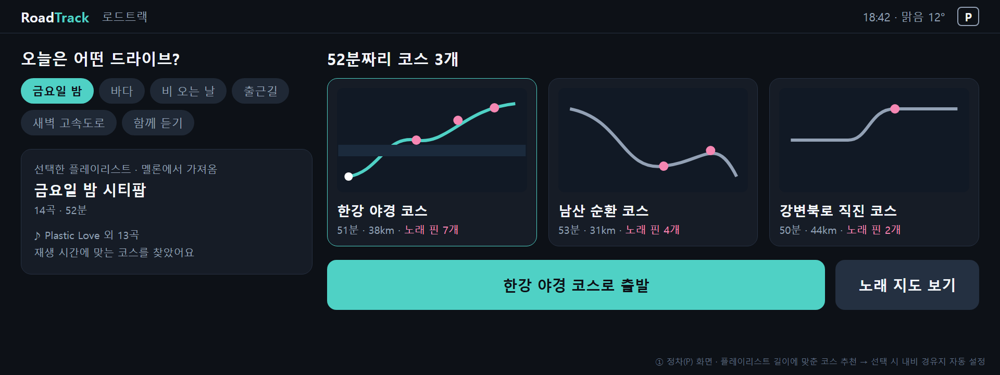
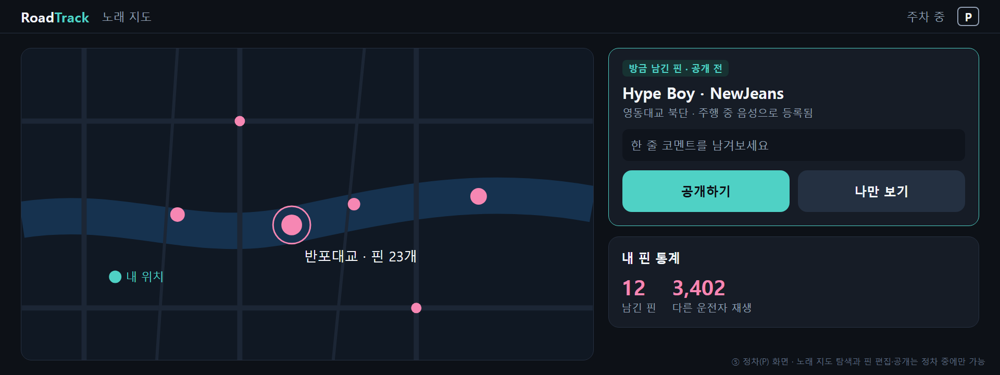
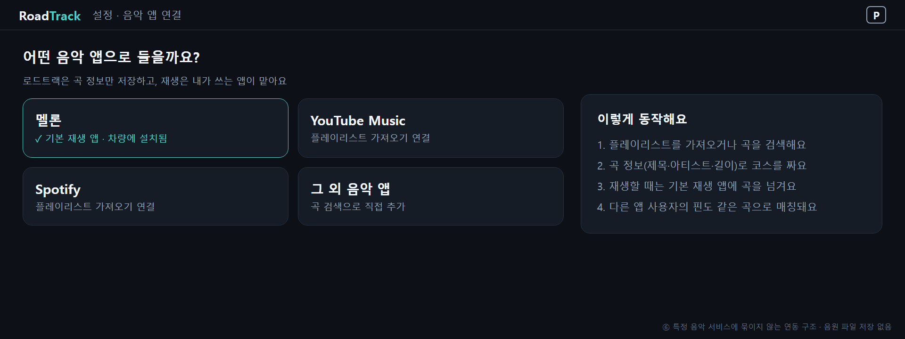

# 로드트랙 (RoadTrack) - 음악으로 고르는 드라이브

내 플레이리스트에 맞춰 드라이브 코스를 짜주고, 길 위에 다른 운전자가 남긴 노래를 들려주는 Pleos Connect 차량용 음악 드라이브 앱입니다.

> 현대자동차그룹 차량용 앱 개발 공모전 출품작

## 주요 기능
- **플레이리스트 맞춤 코스**: 플레이리스트 재생 시간에 맞는 드라이브 코스를 추천하고 내비 경로로 바로 적용
- **노래 핀**: 도로 구간에 노래를 남기고, 그 구간에 들어선 다른 운전자에게 재생
- **상황 인식 추천**: 와이퍼·전조등·좌석 착석 신호로 비·밤·동승자 상황에 맞는 곡 제안
- **앰비언트 무드 라이트**: 곡 분위기에 맞춰 실내 조명 색 변경
- **멀티 음악 앱 지원**: 멜론 등 사용자가 쓰는 음악 앱으로 재생 연결

## 화면 시안
| | |
|---|---|
|  |  |
|  |  |
|  |  |

## 실행 방법
_(개발 진행 중 - 작성 예정)_

## 테스트 환경 및 필요한 설정
- Android API 28 이상, Gradle 8.0 이상, Kotlin
- Pleos Connect SDK: Vehicle, NaviHelper, FusedLocation, TextToSpeech, SpeechToText
- _(세부 설정 작성 예정)_

## Pleos Connect 에뮬레이터 버전 및 화면 규격
_(작성 예정)_

## APK
- 위치: [`apk/`](apk/) (`팀명_앱이름_release.apk`)
